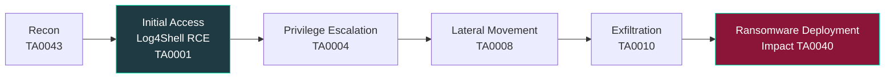

---

## 📖 About This Project

An individual assignment for **Advanced Cyber Security (CT114-3-3-VCS)** at Asia Pacific University. It examines the **2022 ransomware attack on Suffolk County, New York** carried out by the **ALPHV / BlackCat** group, then reproduces the *behaviour* of its initial access in a controlled lab and shows how it can be detected, contained and prevented.

The report is split into two parts:

| Part | Focus | What it covers |
|---|---|---|
| **Section A** | Case study &amp; threat profiling | Attack timeline, targets and impacts, cybercrime profiling of ALPHV, TTPs, MITRE ATT&amp;CK mapping |
| **Section B** | Simulation &amp; defence | Breach/attack simulation, detection action plan, forensics, incident response, cyber playbook, prevention plan |

> ⚠️ **Safety note:** the lab does **not** use the real Log4j exploit or any malware. It uses a harmless Python HTTP service that reacts to a trigger token, so it produces the *same host and network artefacts* without any exploit code.

---

## 🔍 Who Uses This Kind of Analysis and Why

| Audience | How they use it | Why it matters |
|---|---|---|
| **SOC analysts** | Build and tune detections for service-spawned shells (e.g. a service process launching `powershell.exe` or `cmd.exe`) using Sysmon and Event 4688 | Catching the *behaviour* of Log4Shell-style RCE works even before a patch or signature exists |
| **Incident responders** | Follow the containment, evidence-preservation and recovery steps in the IR plan and playbook | A repeatable, evidence-safe process reduces dwell time and protects forensic value |
| **GRC / audit &amp; risk teams** | Use the Suffolk County failures (no CISO, fragmented IT governance, ignored FBI warnings) as a governance case study | Shows that ransomware impact is driven as much by organisational gaps as by technical ones |
| **Threat intelligence teams** | Reuse the ALPHV profile and ATT&amp;CK mapping to anticipate affiliate behaviour | Double-extortion and long dwell time shape how intelligence should be prioritised |
| **Students and trainers** | Reproduce the lab to practise detection engineering and DFIR | A safe, non-destructive scenario for hands-on learning |

---

## 🧭 Case Summary

- **Victim:** Suffolk County, New York (U.S. local government)
- **Threat actor:** ALPHV / BlackCat, a ransomware-as-a-service operation using double extortion
- **Likely entry:** unpatched Apache Log4j service (**CVE-2021-44228**, Log4Shell), around late 2021
- **Dwell time:** months of undetected lateral movement and credential theft
- **Trigger:** ransomware executed on **8 September 2022**; services were down for months
- **Estimated recovery cost:** over **$25 million** (per the sources cited in the report)
- **Root causes:** slow patching, no centralised cyber leadership, weak monitoring, and warnings from federal authorities that were not acted on

### MITRE ATT&amp;CK mapping

| Phase | Tactic | Observed / mapped technique |
|---|---|---|
| Initial access | TA0001 | Exploitation of a public-facing application (Log4j) |
| Privilege escalation | TA0004 | Credential dumping (T1003) |
| Lateral movement | TA0008 | Abuse of remote services (T1021) |
| Exfiltration | TA0010 | Data stolen before encryption (double extortion) |
| Impact | TA0040 | Data encrypted for impact, tied to BlackCat (S1068) |

---

## 🧪 Lab Simulation

| Role | System | Address |
|---|---|---|
| Attacker | Kali Linux (VMware) | `192.168.72.138` |
| Victim | Windows 10 with Sysmon | `192.168.72.141` |
| Target service | Python HTTP service (safe simulation) | `TCP/8080` |

**Attack flow**

1. **Reconnaissance:** confirm IPs, `ping`, then `nmap -Pn -T3` to find exposed ports (135, 139, 445, 3389); correlate with Sysmon Event ID 3 and `netstat -ano`.
2. **Initial access:** an HTTP request carrying a trigger token reaches the vulnerable-style service, which stands in for Log4Shell.
3. **Execution:** the service spawns a child `cmd.exe` / `powershell.exe` that writes a marker file, which is service-initiated execution.
4. **Impact:** the service log and marker file (`simulated_exec.txt`) record each trigger as evidence of system-level effect.

---

## 🛡️ Detection and Forensics

| Evidence source | What it shows |
|---|---|
| **Sysmon Event ID 1** | Process creation with the full command line and parent process |
| **Sysmon Event ID 3** | Network connections used to correlate scanning and discovery |
| **Windows Security Event ID 4688** | Process creation: `python.exe` spawning `powershell.exe -ExecutionPolicy Bypass` |
| **Service access log** | Inbound request and a `TRIGGERED` marker for each hit |
| **Wireshark / PCAP** | Packet-level view of the request and query token |
| **Chainsaw** | Fast offline hunting across exported `Security.evtx` and `Sysmon-Operational.evtx` |
| **SHA-256 hashes** | Integrity and chain of custody for the exported logs |

**Key detection idea:** a long-running service process spawning a command interpreter is a strong behavioural indicator of RCE, independent of the exact exploit used.

**Limitations noted in the report:** false positives from legitimate parent-child processes, no central SIEM (manual correlation), and encrypted traffic limiting deep packet inspection, so host telemetry is the most reliable signal.

---

## 🚨 Incident Response, Playbook and Prevention

**Incident response** follows triage, containment, evidence preservation, eradication, recovery and post-incident review.

**Containment steps demonstrated**
- Isolate the host by disabling the active network adapter
- Block the vulnerable port with a Windows Defender Firewall inbound rule (`Block_8080_Containment`, all profiles)
- Verify containment: the attacker's `curl` to `:8080` fails (exit code 28)
- Preserve evidence: export logs with `wevtutil epl`, capture traffic with `tcpdump`, hash the logs

**Prevention priorities**
- Patch internet-facing services (especially Java components) quickly
- Allowlist and segment access to service ports
- Enable process-creation logging with command-line capture and alert on service-to-PowerShell chains
- Keep immutable or offline backups and test restores
- Enforce least privilege on service accounts and define log-retention and IR policies

---

## 🧰 Tools and Technologies

---

## 📚 References

1. Nir, S. M. (2022). *How a Cyberattack Plunged a Long Island County Into the 1990s.* The New York Times. <https://www.nytimes.com/2022/11/28/nyregion/suffolk-county-cyber-attack.html>
2. Jones, D. (2024). *Suffolk County ransomware attack linked to lack of planning, ignored warnings.* Cybersecurity Dive. <https://www.cybersecuritydive.com/news/suffolk-county-ignored-threat-warnings/727352/>
3. Mousqueton, J. (2021). *Group: alphv.* Ransomware.live. <https://www.ransomware.live/group/alphv>
4. Phipps, A., &amp; Nurse, J. R. C. (2025). *Inside ransomware groups: An analysis of their origins, structures, and dynamics.* Computers &amp; Security, 160. <https://doi.org/10.1016/j.cose.2025.104705>
5. CISA (2024). *#StopRansomware: ALPHV Blackcat.* <https://www.cisa.gov/news-events/cybersecurity-advisories/aa23-353a>
6. Sophos (2022). *BlackCat ransomware attacks not merely a byproduct of bad luck.* <https://www.sophos.com/en-us/blog/blackcat-ransomware-attacks-not-merely-a-byproduct-of-bad-luck>
7. CIS (2022). *Breaking Down the BlackCat Ransomware Operation.* <https://www.cisecurity.org/insights/blog/breaking-down-the-blackcat-ransomware-operation>
8. MITRE ATT&amp;CK (2021). *BlackCat, Software S1068.* <https://attack.mitre.org/software/S1068/>
9. IBM Security (2023). *BlackCat ransomware levels up stealth speed exfiltration.* <https://www.ibm.com/think/x-force/blackcat-ransomware-levels-up-stealth-speed-exfiltration>

---

## ⚖️ Disclaimer

This repository documents an **academic, defensive-security exercise** performed in an isolated lab. No real exploit code or malware is included. Do not run any part of this against systems you do not own or have explicit written permission to test.

---

## 📫 Let's Connect

**Shady** · Cyber Security student, Asia Pacific University

